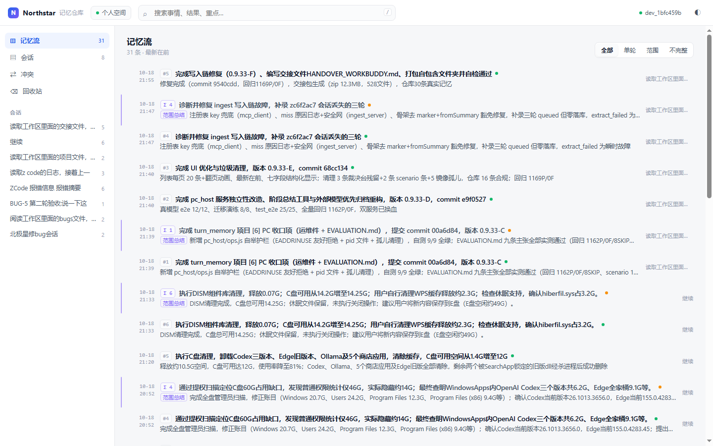
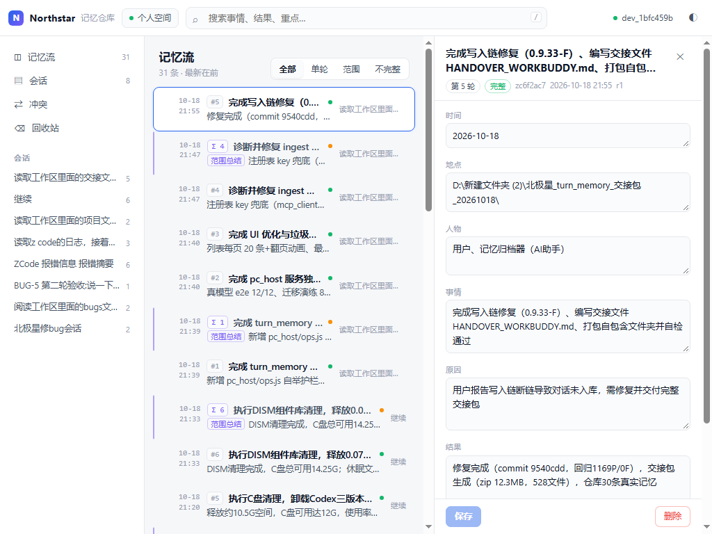
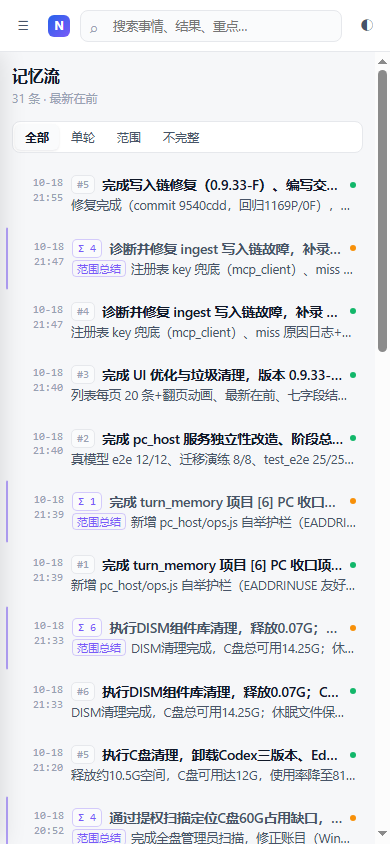
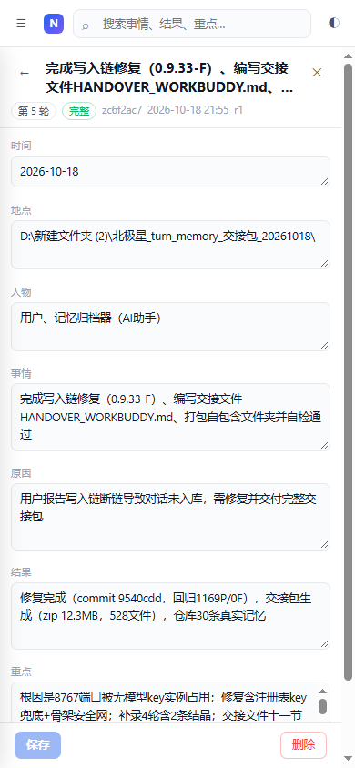
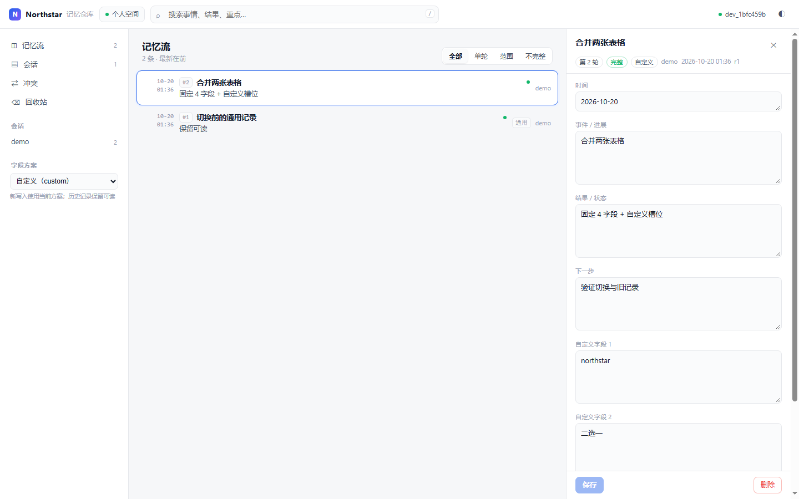

# 北极星记忆 · Northstar Memory

[English](README.en.md) · 中文

一个给 MCP Agent 用的本地优先记忆服务。

- 每轮结束存一张字段表，下一轮开始只带回上一张
- 数据是用户目录里的 JSON 文件，可读、可改、可备份
- 多设备用你自己的云盘 / git 同步，不经过托管服务
- 附带一个可编辑的记忆仓库 UI

## 为什么是这个形状

把“每轮”当作最小单位：每轮存一张字段表，不反复压缩历史；下一轮只注入上一张，
需要更早的信息时再检索。

这样做的代价是 Agent 每轮多调一次工具；收益是记忆不会被多次摘要改写，
并且每条记录都能在 UI 里直接改。

## 三条需求如何被满足

| 需求 | 机制 |
|---|---|
| 每轮总结 | Agent 轮末调用 `memory_save`，提交七字段表（时间/地点/人物/事情/原因/结果/重点）；服务校验并落库，缺字段也保存（标记 `partial`），只给原文也保存（`degraded` 骨架）——截断轮也会保存为骨架，不中断 |
| 上轮注入下轮 | Agent 轮首调用 `memory_recall`，只返回紧邻上一轮一条、≤1200 字符、不含原文；`initialize.instructions` 与 `docs/AGENTS.md` 作为约定 |
| 可编辑仓库 | `http://127.0.0.1:8777`：会话时间线、字段逐字段编辑（带乐观锁）、缺口占位、回收站恢复、服务端分页 |

## 快速开始（MCP 宿主）

1. 安装 Node ≥ 18.17（MCP 走 stdio，不需要数据库、不需要模型 key、不需要联网）。
2. 拿到本目录（已含构建产物 `dist/`，无需 `npm install` 即可运行）。
3. 在宿主的 MCP 配置里加一条：

```json
{
  "mcpServers": {
    "northstar-memory": {
      "command": "node",
      "args": [
        "D:/北极星_turn_memory/dist/server.js",
        "--data", "D:/北极星_turn_memory/data"
      ]
    }
  }
}
```

4. 把 `docs/AGENTS.md`（或压缩版 `docs/SKILL.md`）交给 Agent 作为行为约定。
   服务启动时会自动尝试打开记忆仓库 UI：<http://127.0.0.1:8777>（端口占用则只记日志，不影响 MCP）。

> Claude Desktop / Cursor / ZCode / WorkBuddy / 自研 Agent 同理：任何支持 MCP stdio 的宿主都能接。

## 工具面（默认 3 个，可选 9 个）

默认 **lite 模式**只暴露 Agent 真正需要的三个工具（省 token）：

| 工具 | 作用 |
|---|---|
| `memory_save` | 轮末保存一轮（或范围总结）。天然键 `(session_id, turn_no)`，重复保存=覆盖 |
| `memory_recall` | 轮首取**恰好一条**上一轮总结（或最近范围总结） |
| `memory_search` | 按需检索历史（中文 bigram + 字段加权） |

`--tools full`（或 `tools_mode: "full"`）额外暴露：`memory_get` / `memory_list` / `memory_update` / `memory_delete` / `memory_restore` / `memory_stats`。

> 宿主接入示例（Claude Desktop / Cursor / WorkBuddy / ZCode）见 **[docs/HOSTS.md](docs/HOSTS.md)**。
> 每轮 token 与延迟实测、规模边界、减压开关见 **[docs/LOAD.md](docs/LOAD.md)**：
> 每轮约 600–800 tokens、recall <1ms、无外部模型调用；工具定义 lite 3.1KB / full 5.5KB。

## UI




移动端（侧栏抽屉 + 全屏详情）：




- 左侧导航（记忆流 / 会话 / 冲突 / 回收站）+ 会话列表；中间时间线；右侧详情抽屉
- **自适应布局**：≥1280 三栏；960–1279 收窄；<960 侧栏变抽屉；<760 详情全屏；任意宽度文本自动换行/省略，不横向溢出
- **面板吸附**：拖动详情左边缘在 340/420/520/640 四档吸附，双击复位；宽度记忆在本地
- 七字段**逐字段**编辑，缺失字段琥珀色提示；乐观锁（多设备同时改会提示冲突）
- 范围总结用紫色标线与"范围总结"标签区分，不与单轮混淆
- 删除进回收站（墓碑，可恢复）；编辑保留旧版快照（可回滚）
- 服务端分页（加载更多追加）、全局搜索（`/` 聚焦）、浅色/深色主题、零外部资源
- 前端拆分为 `index.html`（结构）+ `styles.css`（样式）+ `app.js`（逻辑）

## CLI（可选，调试与补录）

```bash
node dist/cli.js save   --session s1 --fields '{"时间":"2026-10-19","事情":"...","结果":"...","重点":"..."}' [--raw "..."] [--truncated]
node dist/cli.js recall --session s1 [--before 12] [--scope range]
node dist/cli.js search "记忆 注入" [--session s1] [--limit 5] [--explain]
node dist/cli.js list   [--session s1] [--page 2]
node dist/cli.js get <id>
node dist/cli.js consolidate --session s1  # 列出还没被巩固覆盖的轮次
node dist/cli.js consolidate --session s1 --covers 1,3,5 --theme 断剑线索 --fields '{...}'
node dist/cli.js versions <id>          # 这条记录的历史版本（编辑快照 + 删除墓碑）
node dist/cli.js undo <id> [--steps N]  # 回退到 N 个版本之前；回退本身也能再回退
node dist/cli.js sessions [--all]
node dist/cli.js stats
node dist/cli.js range  --session s1 --from 1 --to 10
node dist/cli.js export [--out backup.json]
```

全局参数：`--data <dir>`、`--range-every <n>`。

## 两套表格（二选一）

| 方案 | 来源 | 字段 |
|---|---|---|
| `general` 通用 | 内置，默认 | 时间、地点、人物、事情、原因、结果、重点 |
| `custom` 自定义 | 需安装，可改 | 4 个固定字段 + 自定义槽位 |

同一时间只启用一套。启用哪套，**新写入**就用哪套；历史记录保留原方案，仍可阅读/编辑。

```bash
node dist/cli.js profile install custom --file profiles/custom.json
node dist/cli.js profile use custom
node dist/cli.js profile use general     # 切回
node dist/cli.js profile list
```

自定义模板固定 4 个字段（时间 / 事件 / 结果 / 下一步），其余槽位改 `label`、删减或新增即可。
详见 **[docs/PROFILES.md](docs/PROFILES.md)**。



## 升级包（按需安装）

本体只带核心能力；额外能力以「包」的形式安装，**不装也能完整使用**。

```bash
node dist/cli.js pack list                      # 已装 / 已启用
node dist/cli.js pack install packs/export-obsidian
node dist/cli.js pack doctor                    # 兼容性与完整性检查
node dist/cli.js obsidian --out ./vault         # 包注册的命令
node dist/cli.js pack disable export-obsidian   # 停用但不删
node dist/cli.js pack remove export-obsidian    # 卸载；记录里的字段仍只读可见
node dist/cli.js pack rebuild export-obsidian   # 派生数据从真源重放
```

- 已装包会把**自己的工具**并入 `tools/list`（lite 只带标了 `default` 的），工具定义随包装卸，不占没必要的 token。
- 包可以提供：字段方案、MCP 工具、CLI 命令、四个 hook（`compose` 注入补充 / `score` 排序微调 / `onSave` 维护派生数据 / `export` 导出格式）。
- 包加载失败、hook 抛错、派生数据损坏都只降级，**核心照常启动**；连续失败 10 次自动停用。
- 派生数据在 `data/.packs/<id>/`，可随时删掉重建，不参与同步。

现有包：

| 包 | 提供 | 适合 |
|---|---|---|
| `export-obsidian` | 导出 Obsidian 兼容 Markdown vault | 把记忆扔进自己的笔记库 |
| `creative`（文创写作） | `story` 剧情字段 + 触发式注入 + 真相层（`memory_pin`） | 长篇连载、角色扮演、跑团 |
| `safety`（安全合规） | 写入时标记可疑内容（`suspect`）、低信任来源降权、上一轮可疑时提示；`safety scan` 追溯标记 | 会读网页/文件/工具输出的 Agent |

`creative` 的触发式注入是**世界书机制**：记录里填「触发词」（人物名自动算），当前输入命中才带回来，
不命中就不占上下文。钉为「设定」的记录在检索与注入里都优先。

```bash
node dist/cli.js pack install packs/creative
node dist/cli.js pack rebuild creative   # 重建触发索引（从真源重放）
```

架构与写包规范见 **[docs/PACKS.md](docs/PACKS.md)**。

## 跨设备 / 跨网络（本地优先）

**不共用一台设备，也不托管用户数据。** 每台设备都有完整副本，同步走你自己的存储：

- 把 `data/` 放进 OneDrive / iCloud / Syncthing / 坚果云的同步目录，或提交到 git 仓库
- 每台设备跑本地实例（stdio MCP），记录自带 `device_id` 与字段级时间戳
- 同一轮在两台设备被改：同步工具产生冲突副本 → 下次启动自动**逐字段合并**，冲突记入 `data/conflicts/`
- 删除写**墓碑**（`data/tombstones/`），随同步传播，不会"删了又回来"；删除后又被编辑则按时间判定是否复活
- 多人：每人一个 `space`（`data/spaces/<space>/`），互不共用设备；团队共享 = 共享同一同步目录

```bash
# 设备 A 与设备 B 各自跑本地实例，data 放在同一同步目录
node dist/server.js --data "D:/OneDrive/northstar/data"
node dist/cli.js sync doctor   # 查看设备 id / 墓碑 / 冲突合并情况
```

可选：需要让远程/无头设备直接连某台常开机器时，才启用 MCP over HTTP（带令牌）：

```bash
node dist/server.js --data ./data --http-host 0.0.0.0 --http-port 8788 --token <令牌>
```

跨公网优先 Tailscale / Cloudflare Tunnel / SSH 隧道；裸端口必须 HTTPS 反代。
完整说明见 **[docs/REMOTE.md](docs/REMOTE.md)**。

## 配置

`tm.config.json`（项目根，可被 CLI 参数/环境变量覆盖）：

| 键 | 默认 | 说明 |
|---|---|---|
| `data_dir` | `./data` | 数据目录（相对项目根） |
| `ui_host` / `ui_port` | `127.0.0.1` / `8777` | 记忆仓库；非回环需令牌 |
| `http_host` / `http_port` | `127.0.0.1` / `0` | MCP over HTTP（`/mcp`）；0=关闭 |
| `auth_token` | 空 | 远程访问令牌，或环境变量 `TM_AUTH_TOKEN` |
| `tools_mode` | `lite` | `lite`=3 个工具（省 token）/ `full`=9 个 |
| `range_every` | `10` | 每 N 轮自动生成范围总结 |
| `recall_max_chars` | `1200` | 注入块预算 |
| `raw_head` / `raw_tail` | `1200` / `600` | 原文头尾窗口 |
| `packs_dir` | `~/.northstar/packs` | 升级包安装目录（代码，不进数据目录） |
| `decay_half_life_days` | `0`（关闭） | 新鲜度衰减半衰期；实测默认关闭更好，需要时再开 |

环境变量：`TM_DATA_DIR`、`TM_UI_PORT`、`TM_UI_HOST`、`TM_HTTP_PORT`、`TM_HTTP_HOST`、`TM_AUTH_TOKEN`、`TM_RANGE_EVERY`、`TM_TOOLS_MODE`（lite/full）、`TM_PACKS_DIR`、`TM_DEVICE_ID`。

## 数据布局（单一真源，无镜像、无 SQLite）

```
data/
  spaces/<space_id>/space.json      空间元数据（members 预留给团队）
  spaces/<space_id>/sessions/<key>/
    _meta.json                      会话名 / range_every
    turn-0001.json                  一轮一条（七字段 + 原文 + 字段级同步元数据）
    range-0001-0010.json            每 N 轮范围总结
    .rev                            跨进程刷新标记
  tombstones/<record_id>.json       删除墓碑（含完整记录，可恢复；随同步传播）
  conflicts/                        冲突副本归档与合并报告
  .trash/                           编辑快照（可回滚）
  .locks/                           短写锁
  .packs/<pack_id>/                 升级包派生数据（索引/缓存；可删可重建，不参与同步）
  logs/server.log                   运行日志（5MB 轮转）
```

单个字段硬上限 5000 字（超出截断并置 `truncated`，写入永不拒绝）；原文按头尾窗口截断。
一条记录一个 JSON 文件：可读、可 git、可手工修、可直接备份。
`content`（七字段文本）与 `title` 都是读时派生，不落盘，杜绝两处不一致。
每条记录带 `space_id / updated_by / field_meta`，多设备合并时按字段时间戳与设备 id 决胜。

## 从旧版（0.9.x）迁移

```bash
node dist/migrate.js --dry-run --from "<旧>/pc_host/data" --data ./data
node dist/migrate.js --apply   --from "<旧>/pc_host/data" --data ./data --report ./migration/report.json
```

- 只读旧目录（迁移前后旧数据哈希不变）；自动备份旧数据到 `migration/backup_pc_host_data_<ts>/`
- `event → turn`、`topic → range`（`basedOn` 解析 covers，悬空引用进报告）
- 幂等且不覆盖：重复执行只补缺失文件，已存在记录/会话名（含人工修改）一律跳过
- 实测：31/31 条（27 turn + 4 range）、35 个会话名、4 条"缺原因"如实标记

## 备份 / 回滚

- 备份：整目录拷贝 `data/` 即可（纯文件，无数据库）
- 回滚：`mv data data.failed_<ts>` 后重新迁移（幂等）
- 导入导出：`node dist/cli.js export --out backup.json`

## 测试

```bash
npm test        # 27 套件 190 断言：schema/store/recall/range/search/time/mcp/ui/ui-write/sync/migrate/migrate-edge/auth/security/profiles/packs/pack-edge/creative/invariants/safety/undo/consolidate/multi/edge/http/cli
npm run test:unit  # 同上，去掉 CLI/HTTP/多实例（快循环，约 25s）
node --test tests/search.test.mjs   # 最快的姿势：直跑单文件（约 3s，绕开 npm 的 ~9s 启动开销）
npm run test:watch                  # 改动即重跑（node --test --watch）
npm run eval    # 检索质量基线：分类别 Hit@5 / MRR@5 / 延迟 / 注入有界性（CI 门禁 --min-hit 0.92 --min-mrr 0.86）
npm run smoke   # 发布冒烟：打包 → 装进干净目录 → 当真实用户跑一遍（CI 上也跑）
npm run build   # TypeScript 构建（仅开发需要；dist/ 已随包提供）
```

## 文档

- [AI 记忆全景调研（2026-10）](docs/RESEARCH.md)：竞品矩阵、研究共识、功能优先级
- [GitHub 生态扫描](docs/RESEARCH-GITHUB.md)：693 个相关仓库、功能词频、偏门项目
- [相邻领域零件库](docs/RESEARCH-ADJACENT.md)：1037 个非记忆项目的「零件 → 记忆用途」映射
- [更边缘的一层](docs/RESEARCH-EDGE.md)：769 个上游项目，推翻了前一轮的三个判定
- [按人群扫](docs/RESEARCH-DOMAINS.md)：理工与文创的土办法——世界书触发式注入、故事圣经、ADR
- [四轮总整合](docs/RESEARCH-SYNTHESIS.md)：3704 个仓库的合并分析、收敛结论与最终路线图
- [可选升级规划](docs/UPGRADE-PLAN.md)：供需对照与六个升级包（文创/交接/生命周期/检索/安全/导出）
- [质量模型](docs/QUALITY.md)：十个维度的体检、排序短板与评测集
- [本体与升级包](docs/PACKS.md)：按需安装的模块化架构规范
- [Agent 协议](docs/AGENTS.md) · [压缩版 Skill](docs/SKILL.md)
- [宿主接入](docs/HOSTS.md) · [数据格式](docs/DATA_FORMAT.md)
- [多设备同步](docs/REMOTE.md) · [压力实测](docs/LOAD.md)
- [发布手册](docs/PUBLISH.md) · [产品与商业化](docs/PRODUCT.md)

## 明确不做（当前版本的范围护栏）

当前版本不接外部模型/向量检索；不做 SQLite/镜像/双写；不移植插件与宿主钩子；
不做结晶/lint/裁决台；不做多用户/鉴权/云同步；不做自动抓取对话。
（其中“可选向量检索、团队空间、加密同步”属于调研后的候选方向，未排期。）
**没有钩子就无法 100% 强制 Agent 保存**——这是"下载即用"的代价，用约定文档 + 缺口提示 + UI 补记兜底。

## License

MIT — 见 [LICENSE](LICENSE)。
